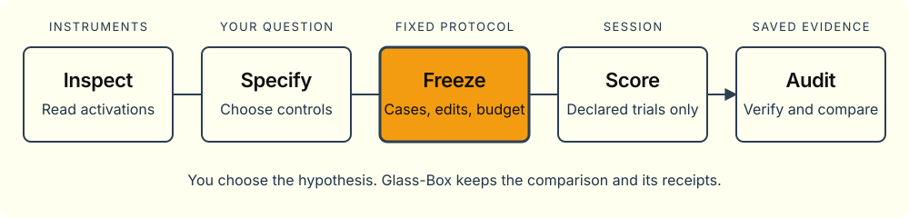

# Glass-Box

**Inspect activations. Test a fixed hypothesis. Keep the evidence.**

Glass-Box is a Python library for inspecting language-model activations, making
scoped interventions, and recording fixed, auditable studies. You choose the
question, cases, edits and controls. The runner executes the declared
likelihood-scoring trials and retains what happened, including failures.

[**Explore the documentation**](https://xmattwest.github.io/glass-box/) ·
[Visual walkthrough](https://xmattwest.github.io/glass-box/docs/how-we-investigate-lfm3.html) ·
[API reference](https://xmattwest.github.io/glass-box/docs/api/) ·
[Agent guide](docs/agents.md)



## Start without a model

Python 3.12 on macOS or Linux. Install from this repository:

```sh
git clone https://github.com/xmattwest/glass-box.git
cd glass-box
python3.12 -m pip install .
```

Run the complete study path with invented fixture arithmetic:

```sh
glass-box examples --output ./my-studies
glass-box validate ./my-studies/code_retrieval.json
python3.12 ./my-studies/fake_walkthrough.py --output ./synthetic-demo --summary
glass-box report ./synthetic-demo/code-retrieval-mechanics-v2
python3.12 ./my-studies/audit_controls.py ./synthetic-demo/code-retrieval-mechanics-v2 --tolerance 0.000001
```

No weights, API key, PyTorch or worker are needed. Synthetic scores test software,
not model behavior. `--output` retains protocols, journals and raw receipts;
`--summary` prints a compact view. Reports verify saved evidence without rescoring.
Use a new output directory for a fresh walkthrough. Holdout stays unrun.

## What the library provides

| Instruments | Fixed studies | Evidence |
| --- | --- | --- |
| Activation probes, local gradient attribution, finite ablations, temporary patches and greedy generation with telemetry replay | Explicit cases, conditions, objectives, splits and budgets; serialized local/remote sessions | Protocol fingerprints, attempt journals, raw receipts, bounded resumption and hash-verified paired reports |

The initial adapter targets
`LiquidAI/LFM3-1.7B@40ebe0aa6662c9d40389c2f5d565b6a2c6aebacd`.
The distribution is `glass-box`; Python imports use `lfm3lab` for compatibility.
`lfm3-research` remains a CLI alias.

**A likelihood change is not generated correctness, a native circuit or a
practical benefit.** The study runner does not choose hypotheses, search for
circuits, or evaluate generated answers automatically. No model weights,
research results, browser application or cloud provisioning are bundled.

## Choose an installation

| Install from the checkout | Use |
| --- | --- |
| `pip install .` | Protocols, reports, synthetic examples and remote clients |
| `pip install '.[instruments]'` | PyTorch instruments and the full CPU fixture suite |
| `pip install '.[local]'` | Model loading on an explicitly authorized host |

Installation and status do not load weights. Local session operations can load
the pinned checkpoint and execute its custom code. CPU/MPS loading requires an
additional opt-in. The remote transport connects to existing hardware; it never
rents it. Model terms are separate from the library license.

`validate` checks schema only, not native coordinates, tokenization or GPU
readiness. Study budgets count attempts, not GPU forward passes or provider
billing. Direct calls and outside setup need separate bounds; lazy loading and
reference work inside a score are charged to that attempt. Read the
[real-model preflight checklist](docs/library-guide.md#before-real-model-work)
before requesting execution.

## Learn the interfaces

- [Visual walkthrough](docs/how-we-investigate-lfm3.html): workflow, sites and predictor-position scopes.
- [Library guide](docs/library-guide.md): Python usage, ownership, budgets and operational limits.
- [API reference](docs/api/index.html): source-derived signatures, fields, methods and constants.
- [Agent guide](docs/agents.md): smallest entry points, wire payloads, failure handling and claim limits.
- [Documentation map](llms.txt): select only the references you need.

Agent guides and the Markdown/JSON API are bundled in the wheel. Read them through
`importlib.resources.files("lfm3lab").joinpath("docs")` without loading a model.
The package is not published to a package index.

## Contribute without mixing in experiments

Keep library changes here and study plans, analysis, environments and evidence in
a separate research workspace. A study should consume an identified installed
wheel outside the checkout. Experimental friction becomes a reduced synthetic
regression and a general library fix, not committed live receipts.

See [research and library boundaries](docs/research-workflow.md) and
[contributor instructions](AGENTS.md).

```sh
uv sync --extra instruments
uv run python scripts/build_docs.py --check
uv run glass-box check
uv run python -m unittest discover -s tests -v
uv build
uv run python scripts/wheel_smoke.py dist/glass_box-0.1.0-py3-none-any.whl
```

Public CI uses model-free CPU checks. Historical GPU receipts identify their
source build and runtime; they do not validate arbitrary versions or all
instruments. Before publication, follow the
[release checklist](docs/release-checklist.md).
For documentation changes, see the [static site guide](docs/site-guide.md).

## License and provenance

[Apache-2.0](LICENSE). [NOTICE](NOTICE) retains decoder attribution; the model has
separate terms. Read [code provenance](docs/provenance.md) and the
[extraction report](docs/extraction.md).

Presentation follows Warm Precision principles: clear hierarchy, restrained
color, readable type and specific claims. No design-system runtime is required.
